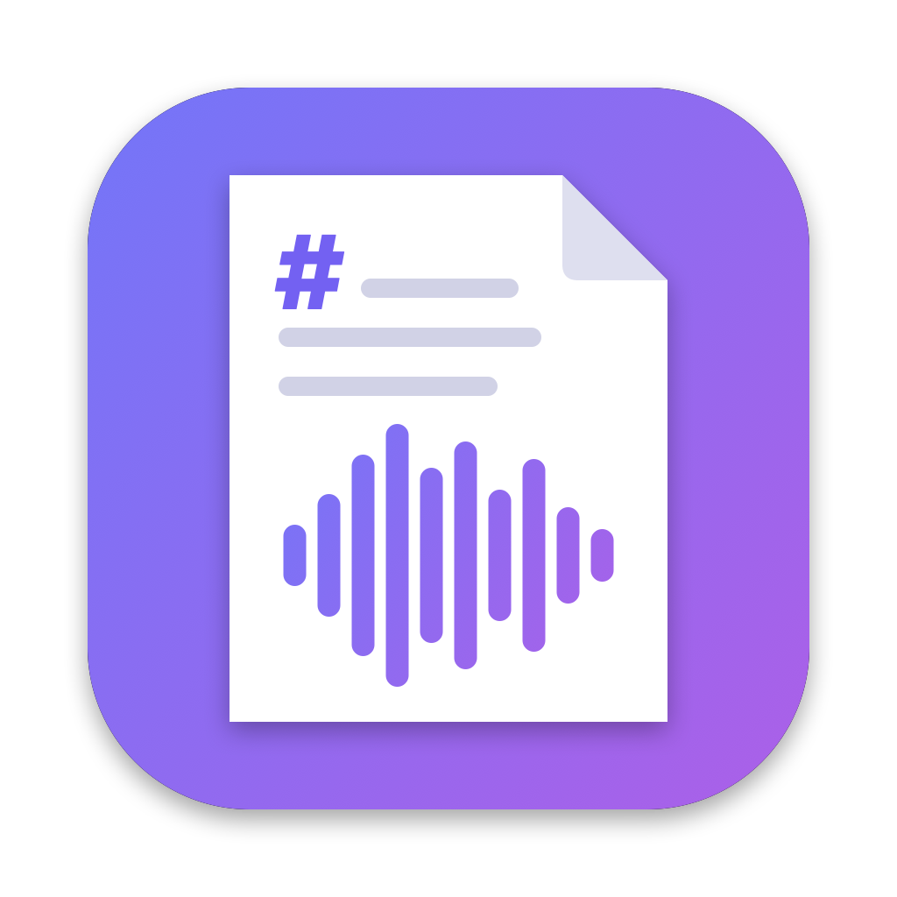

# MD2Audio



**MD2Audio** è un'app SwiftUI **completamente nativa**: usa le voci di sistema di macOS
e non richiede software aggiuntivo. Trascini un file Markdown (oppure scrivi o incolli il testo), scegli
lingua e voce, regoli la lettura e ottieni un file WAV o M4A, che puoi ascoltare direttamente nell'app.

In modalità Text → Audio, a sinistra c'è l'editor del testo: il file trascinato o scelto viene caricato lì
e puoi modificarlo prima della conversione (il file originale non viene modificato). Puoi anche scrivere
direttamente, incollare con ⌘V o con il pulsante **Paste**, e svuotare l'editor con **Clear**. Viene letto
esattamente il testo presente nell'editor. L'audio viene salvato accanto al file caricato oppure, per il
testo scritto o incollato, in `Documenti/Speech.m4a` (modificabile con **Change…**).

L'app ha due modalità, selezionabili in alto nella finestra:

- **Text → Audio**: da Markdown a file audio (descritta sotto);
- **Audio → Text**: trascrizione di un file audio (vedi [Da audio a testo](#da-audio-a-testo)).

## Opzioni

| Opzione | Effetto |
|---|---|
| Speed / Pitch | Velocità e tono della voce |
| Pause between sentences | Silenzio extra tra le frasi (le frasi sono riconosciute in base alla lingua) |
| Pause at commas and dashes | Silenzio extra dentro le frasi: dopo le virgole (1×), dopo `;` e `:` e ai trattini staccati ` - `, `–`, `—` (2×, letti come pausa e non come "meno"), e per ogni spazio in più tra le parole (1× per spazio, max 6×). Numeri come `3,5` o `10:30` e parole come `e-mail` non sono toccati. 0 = disattivato |
| Pause between blocks | Moltiplicatore delle pause dopo titoli, paragrafi ed elenchi |
| Variation | Piccola variazione casuale di velocità e tono per ogni frase, per rendere la lettura meno monotona |
| Read headings slower and lower | I titoli vengono letti un po' più lenti e con tono più basso |
| Stress bold and italic text | Grassetto e corsivo vengono letti più lenti, con tono più alto e volume leggermente maggiore |
| Skip emoji | Le emoji non vengono lette |
| Pronunciations | Una regola per riga, `parola = come dirla` (es. `API = a pi i`) |
| Format | WAV (non compresso) o M4A (AAC, file molto più piccoli) |

## Sintassi

Oltre alle opzioni, alcuni elementi del testo cambiano la lettura (il pulsante **Syntax** sopra l'editor
mostra questa tabella con le durate correnti; la stessa guida è anche nel menu *Aiuto › MD2Audio Help*, ⌘?):

| Nel testo | Effetto |
|---|---|
| `# Titolo` | Letto più lento e più basso, con una pausa prima e dopo |
| `**grassetto**`, `*corsivo*` | Enfasi: un po' più lento, più alto e più forte |
| `***` o `---` su una riga a sé | Separatore di sezione: pausa di 2 s |
| `...` o `…` | Pensiero sospeso: pausa di 500 ms |
| `,` `;` `:` ` - ` `–` `—` e spazi in più | Pause dentro la frase (vedi *Pause at commas and dashes*) |
| Codice, immagini, tabelle | Non vengono letti |

Le pause dei titoli e dei separatori sono scalate da *Pause between blocks*.

Il pulsante **Preview** legge i primi blocchi del testo (o una frase di esempio) con le impostazioni correnti.

## Voci

La differenza più grande la fa la voce: quelle *Enhanced* e *Premium* sono molto più naturali di quelle
compatte. Il pulsante **Download Voices…** apre *Impostazioni di Sistema › Accessibilità › Contenuti
letti ad alta voce*: da lì apri il menu *Voce di sistema*, scegli *Gestisci voci…* e scarica le voci che
ti interessano. L'app le rileva subito e le mostra per prime.

## Da audio a testo

Nella modalità **Audio → Text** trascini un file audio (WAV, M4A, MP3, AIFF, CAF…), scegli la lingua e
premi **Transcribe**. Il riconoscimento avviene interamente sul Mac, con il motore `SpeechAnalyzer`
di Apple: niente invio a server, nessun limite di durata. Il modello della lingua viene scaricato
automaticamente al primo utilizzo; nel menu le lingue già scaricate sono segnate con *downloaded*.

È molto veloce: 40 minuti di audio vengono trascritti in circa 25 secondi.

| Formato | Contenuto |
|---|---|
| Text | Testo semplice, un paragrafo per ogni tratto di parlato |
| Markdown | Titolo (nome del file) e paragrafi; il file può essere riconvertito in audio |
| Subtitles (SRT) | Sottotitoli con tempi, righe di massimo ~84 caratteri / 6 secondi |

L'opzione **Timestamps** aggiunge l'orario di inizio a ogni paragrafo (Text e Markdown).
Il testo resta modificabile prima di copiarlo o salvarlo con **Save As…**.

Richiede **macOS 26** o successivo; sulle versioni precedenti è disponibile solo Text → Audio.

## Compilare l'app

Requisiti:

- macOS 14 (Sonoma) o successivo per eseguire l'app (macOS 26+ per la trascrizione)
- per compilare: SDK di macOS 26 (Xcode 26+) **oppure** i relativi Command Line Tools (`xcode-select --install`)

Compilazione e pacchetti per la distribuzione:

```sh
./build_app.sh
```

Lo script:

1. compila un binario *Universal* (Apple Silicon + Intel) in modalità release;
2. crea `build/MD2Audio.app` con icona e `Info.plist`;
3. firma l'app (ad-hoc, oppure con un Developer ID se indicato);
4. crea in `dist/` un'immagine disco `MD2Audio-<versione>.dmg` (con il collegamento ad
   *Applicazioni* per l'installazione trascinando) e uno `MD2Audio-<versione>.zip`.

Variabili d'ambiente opzionali:

| Variabile | Esempio | Effetto |
|---|---|---|
| `VERSION` | `VERSION=1.1` | Numero di versione dell'app e nome dei file in `dist/` (default `1.0`) |
| `SIGN_IDENTITY` | `"Developer ID Application: Nome (TEAMID)"` | Firma con un certificato Developer ID e *hardened runtime* |
| `NOTARY_PROFILE` | `md2audio` | Invia il DMG ad Apple per la notarizzazione e allega il ticket (richiede `SIGN_IDENTITY`) |

Per lo sviluppo, senza creare il bundle:

```sh
swift run
```

oppure apri `Package.swift` con Xcode.

Struttura del codice:

```
md2audio/
├── Package.swift
├── build_app.sh               # build, firma e pacchetti DMG/ZIP
├── Icon/
│   ├── make_icon.swift        # disegna l'icona e genera Resources/AppIcon.icns
│   └── AppIcon.png            # anteprima 1024×1024
├── Resources/AppIcon.icns
└── Sources/MD2Audio/
    ├── MD2AudioApp.swift      # entry point
    ├── ContentView.swift      # finestra principale, scelta della modalità
    ├── SpeakView.swift        # Text → Audio: interfaccia e opzioni
    ├── SyntaxHelp.swift       # aiuto sulla sintassi che cambia la lettura
    ├── SpeechScript.swift     # Markdown -> blocchi -> SSML (pause, prosodia, enfasi, pronunce)
    ├── AppleSpeech.swift      # sintesi con AVSpeechSynthesizer, scrittura WAV/M4A, anteprima
    ├── Converter.swift        # conversione con avanzamento e annullamento
    ├── PlayerView.swift       # lettore audio integrato
    ├── TranscribeView.swift   # Audio → Text: interfaccia
    ├── Transcriber.swift      # trascrizione con SpeechAnalyzer, formati Text/Markdown/SRT
    └── FileDropZone.swift     # area di trascinamento dei file
```

Per modificare l'icona, cambia `Icon/make_icon.swift` e rigenerala con:

```sh
swift Icon/make_icon.swift
```

## Condividere l'app

Condividi il file `dist/MD2Audio-<versione>.dmg`. Chi lo riceve lo apre e trascina
**MD2Audio** nella cartella *Applicazioni*.

Senza un certificato *Developer ID* l'app è firmata solo ad-hoc, quindi al primo avvio macOS la blocca
("Apple non può verificare che MD2Audio sia privo di malware"). Basta autorizzarla una volta:

1. apri l'app e chiudi l'avviso;
2. vai in *Impostazioni di Sistema › Privacy e sicurezza*, scorri fino al messaggio su MD2Audio e
   clicca **Apri comunque**, poi conferma.

In alternativa, da Terminale:

```sh
xattr -dr com.apple.quarantine /Applications/MD2Audio.app
```

Per evitare del tutto l'avviso serve l'iscrizione all'[Apple Developer Program](https://developer.apple.com/programs/)
e un certificato **Developer ID Application** (un certificato *Apple Development* non basta). Poi:

```sh
# una sola volta: salva le credenziali per la notarizzazione nel portachiavi
xcrun notarytool store-credentials md2audio \
  --apple-id tua@email.com --team-id TEAMID --password <password-specifica-per-app>

SIGN_IDENTITY="Developer ID Application: Nome (TEAMID)" NOTARY_PROFILE=md2audio \
  VERSION=1.0 ./build_app.sh
```

Il DMG risultante si apre su qualsiasi Mac senza avvisi.

## Risoluzione dei problemi

- **La voce suona robotica**: scarica una voce *Enhanced* o *Premium* (vedi [Voci](#voci)).
- **Pronuncia sbagliata o accento strano**: la voce e la lingua devono corrispondere; per singole
  parole usa le *Pronunciations*.
- **Il Markdown "non ha testo"**: se il documento contiene solo codice, tabelle o immagini,
  non c'è nulla da leggere.
